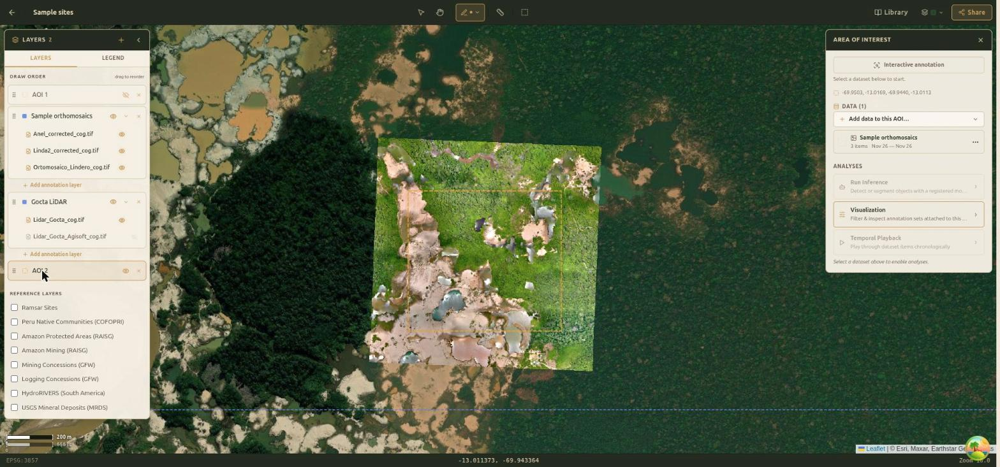

# Areas of interest

An **area of interest (AOI)** is a study area you draw on the map and save, such as a forest plot, a river section or a mining concession.

## Why AOIs matter

AOIs keep your work focused on the places you care about. You can use an AOI to:

- **Search for imagery** that covers that area.
- **Run a model only inside it**, instead of over a whole image, which is faster and avoids results you do not need.
- **Filter results**, so reports and exports only include what falls inside the area.
- **Compare areas**, by running the same workflow over several AOIs and reporting on each one.

<figure class="doc-figure">
  
  <figcaption>A saved AOI (orange rectangle). Selecting it opens the Area of interest panel with its coordinates, the data attached to it and its analyses.</figcaption>
</figure>

## AOIs are saved

GeoTALOS stores each AOI as a geographic shape in the database. Once saved, it can be reused in any map or workflow, and when new imagery arrives the same AOI can be monitored again without redrawing it.

See the [Multi-AOI palm analysis](../tutorials/multi-aoi-palm-analysis.md) tutorial for an example.
