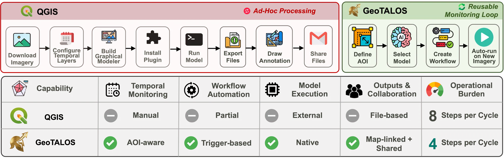

# Key Concepts

A few ideas come up throughout GeoTALOS. Reading these first will make the rest of the guide easier to follow.

- [Organizations, projects and roles](organizations.md): how teams share GeoTALOS, and what viewers, members and admins can do.
- [Datasets and the data library](datasets.md): how imagery is stored, catalogued and found.
- [Areas of interest](aois.md): saved study areas that focus searches, model runs and reports.
- [Annotation sets](annotations.md): how predictions become reviewed, trustworthy map layers.
- [Workflows and nodes](workflows.md): monitoring procedures built visually from connected steps.
- [Provenance](provenance.md): the record of how every result was produced.

## GeoTALOS compared with a desktop GIS routine

In a desktop GIS such as QGIS, each monitoring cycle repeats about eight manual steps: download imagery, set up temporal layers, build a chain in the Graphical Modeler, install a plugin, run the model, export files, draw annotations and share files. In GeoTALOS you define the AOI, choose a model and build the workflow once, and it then runs again on new imagery.

<figure class="doc-figure">
  
  <figcaption>A QGIS centred routine and the GeoTALOS monitoring loop. Figure 10 of the GeoTALOS paper (SIGSPATIAL 2026).</figcaption>
</figure>
