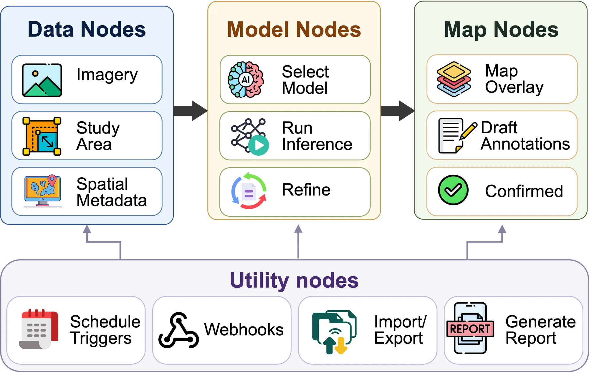

# Workflows and nodes

A **workflow** is a monitoring procedure built from connected steps called **nodes**. Instead of writing scripts, you build it visually: choose your imagery, pick a model, send the results to a map and generate a report.

## Nodes

Each node does one job, and the connections between nodes pass things along: imagery, model selections, predictions, metrics or reports.

Nodes come in four groups. A typical workflow runs left to right: **Data** nodes choose the imagery and study area, **Model** nodes analyse it, and **Map** nodes put the results on the map for review. **Utility** nodes sit underneath and can join in at any step, for example to start the workflow on a schedule or to export the results.

<figure class="doc-figure">
  
  <figcaption>Workflow node groups. Figure 2 of the GeoTALOS paper (SIGSPATIAL 2026).</figcaption>
</figure>

| Group | What the nodes do | Examples |
|---|---|---|
| **Data** | Choose what to work on | Imagery, study area, spatial metadata |
| **Model** | Run analysis | Select model, run inference, refine |
| **Map** | Put results on the map for review | Map overlay, draft annotations, confirmed annotations |
| **Utility** | Automate and share | Schedule triggers, webhooks, import and export, generate report |

## Checked before it runs

Before a workflow starts, GeoTALOS checks that every node is set up correctly and that the connections make sense. Mistakes are caught before any imagery is processed or any model is run.

## Run once, or keep monitoring

A workflow can be run:

- **By hand**, whenever you need it.
- **On a schedule**, for example every month.
- **Automatically**, when something happens, such as new imagery arriving.

Long steps like running a model work in the background, so you can keep using the map while they finish. Because the AOI, model and steps are saved with the workflow, the same monitoring can be repeated on new imagery with no extra setup.

See [Building workflows](../user-guide/building-workflows.md) and [Automation](../user-guide/automation.md).
