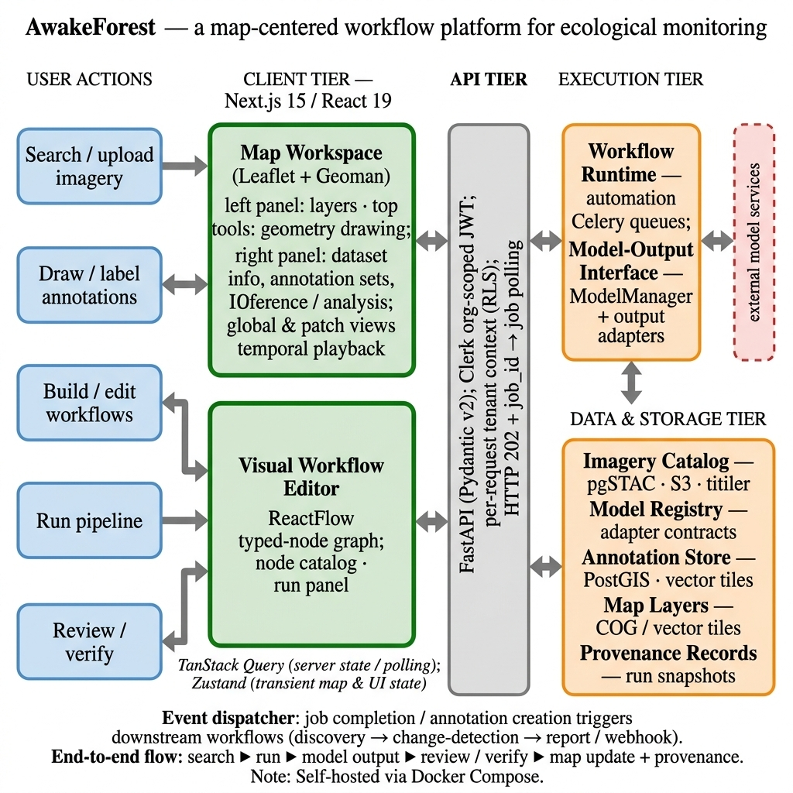

# Architecture

GeoTALOS is split into four tiers. Interactive map use stays fast because slow work (ingestion, model inference, exports) runs in background workers, and all data and storage services are open source and self-hostable.

## The four tiers

| Tier | Components | Repository |
|---|---|---|
| **Client** | Next.js and React; Leaflet with Geoman for drawing and editing geometry; ReactFlow for the visual workflow editor; TanStack Query and Zustand for state | [GeoTalosUI](https://github.com/spygaurad/GeoTalosUI) |
| **API** | Asynchronous FastAPI with Pydantic v2; Clerk organization-scoped JWT authentication; PostgreSQL row-level security | [GeoTalosProd](https://github.com/spygaurad/GeoTalosProd) |
| **Execution** | Celery workers on named queues with a Redis broker; Celery Beat for schedules; an automation engine that runs typed workflow graphs | GeoTalosProd |
| **Data and storage** | PostgreSQL with PostGIS for application data; a separate pgSTAC database for the imagery catalog; MinIO (S3-compatible) object storage; TiTiler for raster tiles; Martin for vector tiles | GeoTalosProd |

## How a request flows

1. The **client** sends a request with the user's Clerk token.
2. The **API** checks the token, sets the organization (tenant) context and runs the query under row-level security, so each organization only ever sees its own rows. See [Multi-tenancy](multi-tenancy.md).
3. Quick operations return directly. Slow ones (ingestion, inference, export) are queued as **Celery jobs**, and the client polls the job status.
4. **Imagery** stays in object storage as COGs and is tiled on demand by TiTiler. **Annotation geometry** lives in PostGIS and is served as vector tiles through Martin, behind an authenticated API endpoint. See [Tiles, caching and reference layers](tiles.md).

## Two databases

| Database | Holds |
|---|---|
| **app-db** (PostgreSQL + PostGIS + pgvector) | Organizations, projects, maps, AOIs, annotations, workflows, jobs and provenance |
| **stac-db** (pgSTAC) | The imagery catalog: one STAC Collection per dataset, one STAC Item per scene |

Keeping them separate keeps tenant-scoped workflow state apart from catalog metadata. Background workers carry the organization context with each job, so tenant boundaries hold in both databases during queued execution.

## Worker queues

Named queues stop long jobs from blocking interactive use. Each worker container listens to its own queues:

| Worker | Queues | Typical jobs |
|---|---|---|
| `celery-worker-ingestion` | `ingestion`, `discovery` | Validating and cataloguing uploaded imagery |
| `celery-worker-bulk` | `bulk` | Bulk imports and purges |
| `celery-worker-analysis` | `analysis`, `automation` | Analysis steps and workflow runs |
| `celery-worker-inference` | `inference`, `embedding`, `training` | Model inference, embeddings, training |
| `celery-worker-default` | `default` | Everything else |

Flower (port 5555) shows queue and worker status.

## Model services

Models are not built into the API. They are registered in the model registry and reached through a shared output-adapter contract, so a new model can be added without changing the workflow runtime. See [Adding a model](adding-a-model.md).

The `geoops-service` container is a separate GPU service for training and serving models with a shared backbone (DINOv2 today) and trainable heads. It is kept in its own image so heavy ML dependencies (PyTorch, Transformers) stay out of the API and worker images. See [Model training pipeline](training-pipeline.md).
