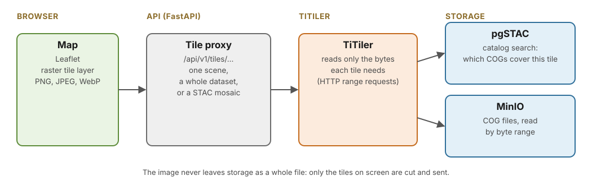
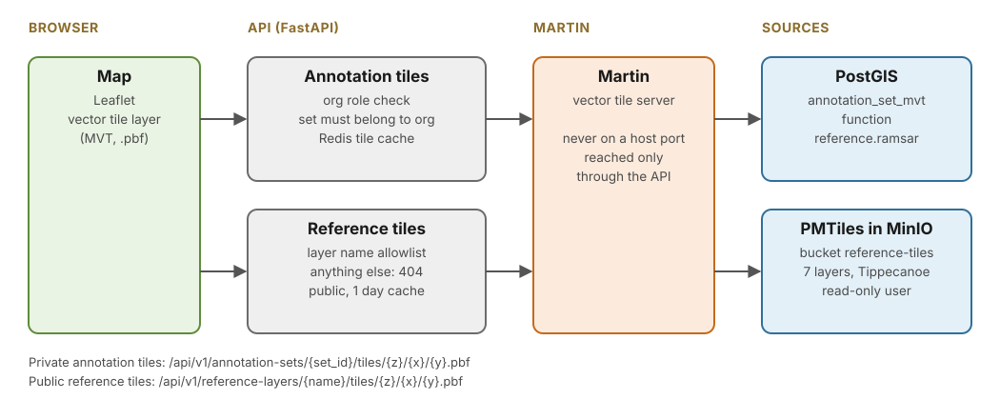

# Tiles, caching and reference layers

GeoTALOS never sends a whole image or a whole annotation set to the browser. Everything on the map is cut into tiles and only the tiles on screen are loaded.

| What | Tile type | Served by | Through |
|---|---|---|---|
| Imagery (COGs) | Raster (PNG, JPEG, WebP) | TiTiler | `/api/v1/tiles/...` |
| Annotation sets (private) | Vector (MVT, `.pbf`) | Martin from PostGIS | `/api/v1/annotation-sets/{set_id}/tiles/{z}/{x}/{y}.pbf` |
| Reference layers (public) | Vector (MVT) | Martin from PostGIS or PMTiles | `/api/v1/reference-layers/{name}/tiles/{z}/{x}/{y}.pbf` |
| Uploaded vector layers (private) | Vector (MVT) | Martin from PostGIS | `/api/v1/feature-layers/layers/{name}/tiles/{z}/{x}/{y}.pbf` |

## Raster tiles

<figure class="doc-figure">
  
  <figcaption>Raster tiles: browser, API tile proxy, TiTiler, then pgSTAC and the COGs in MinIO.</figcaption>
</figure>

COGs stay in MinIO and TiTiler reads only the bytes needed for each tile. The API forwards requests such as:

- `/api/v1/tiles/collections/{collection_id}/items/{item_id}/{z}/{x}/{y}.{fmt}` for one scene
- `/api/v1/tiles/collections/{collection_id}/{z}/{x}/{y}.{fmt}` for a whole dataset
- `/api/v1/tiles/mosaic/{searchid}/{z}/{x}/{y}.{fmt}` for a mosaic of a STAC search

Raster and vector requests share one forwarding helper (`forward_tile`), so errors and headers are handled the same way.

## Annotation vector tiles

<figure class="doc-figure">
  
  <figcaption>Vector tiles: Martin is reached only through the API, which checks the organization or the layer allowlist first.</figcaption>
</figure>

### Why tiles instead of GeoJSON

Loading a whole annotation set as GeoJSON sends every feature on every request. For a 2,000-polygon set in the same session:

| Path | Bytes | Time (p50) |
|---|---|---|
| GeoJSON, whole set | 870,522 | 729 ms |
| MVT, one zoom 14 screen (15 tiles) | 92,171 | 380 ms |
| MVT, same screen right after an edit | 92,171 | 471 ms |
| MVT, one zoom 16 screen (24 tiles) | 20,061 | 566 ms |

Most of the per-tile time (about 23 ms) is the authentication and organization check; generating a tile adds about 6 ms. The `/features` GeoJSON endpoint still exists for exports and small sets.

### How a request is served

1. `require_org_role("org:viewer")` checks the token and organization.
2. The annotation set is loaded **for that organization**. A set from another organization, or a deleted one, returns 404.
3. Tile coordinates are validated (zoom 0 to 22, `x` and `y` inside the zoom level), otherwise 422.
4. The cache key is built: `tile:{org_id}:{set_id}:{tile_version}:{z}:{x}:{y}`.
5. On a cache miss, the API asks Martin for `annotation_set_mvt/{z}/{x}/{y}?set_id=...&v={tile_version}` and stores the result.
6. The response goes out as `application/x-protobuf` with `Cache-Control: private, no-store`, so browsers and shared proxies never keep a copy.

Martin connects with a role that bypasses row-level security, so it is never exposed on a host port. Step 2 is the only thing standing between a caller and another organization's annotations. See [Multi-tenancy](multi-tenancy.md).

### `tile_version` and cache invalidation

Every annotation set has a `tile_version` (migration 071). PostgreSQL triggers advance it on any insert, update, delete or move of an annotation, from any code path: the API, bulk imports, inference and analysis.

Because the version is part of the cache key, an edit makes all old keys unreachable. Nothing is purged on write and no TTL is needed to decide freshness. The version is also passed to Martin (`v=`), because Martin caches by URL and would otherwise keep serving stale bytes.

!!! note "Concurrency"
    The trigger locks the set row with `FOR NO KEY UPDATE`. The first version used `FOR UPDATE`, which deadlocked two concurrent imports into the same set because each INSERT already holds a KEY SHARE lock through the foreign key. Two concurrency tests cover this.

### Redis tile cache

- Runs as its own Redis instance (`redis-tiles`, set with `TILE_CACHE_REDIS_URL`), so tile bytes can never evict Celery queue or result data.
- If it is empty or down, tiles are still served straight from Martin.
- A repeated tile request went from about 228 ms to 22 ms locally.

### What each tile feature carries

The `annotation_set_mvt` function (migrations 072 and 073) puts all annotation data on each feature as flat values:

`id`, `class_id`, `confidence`, `annotation_set_id`, `dataset_item_id`, `created_by_user_id`, `created_by_job_id`, `created_at`, `updated_at`, `review_status`, `aoi_id`, `aoi_name`, `source`, `source_type`, `verified`, `model_id`, `model_name`, and `aoi_bbox` as a JSON string (tiles cannot hold arrays).

This made tiles larger: about +2 KB at zoom 14 and under +1 KB at zoom 16 on a fully populated set. If anything needs trimming later, `created_at` and `updated_at` are the first candidates.

## Reference layers

Public context layers are global and read-only: every signed-in user, in any organization, can see them.

| Layer | Storage | Notes |
|---|---|---|
| Ramsar wetland sites | PostGIS table `reference.ramsar` | Served live by `reference.ramsar_mvt()`, with a simplified geometry used at zoom 6 and below. 7,458 rows. |
| COFOPRI native communities, RAISG protected areas, RAISG mining, GFW mining concessions, GFW logging concessions, HydroRIVERS, USGS MRDS, OpenStreetMap roads | PMTiles in the MinIO `reference-tiles` bucket | Built with Tippecanoe. Martin reads them over S3 with a read-only MinIO user. |

- `GET /api/v1/reference-layers` lists the layers and their tile URLs.
- Only names on an **allowlist** are forwarded to Martin. Anything else, including path tricks, returns 404, so private annotation sources cannot be reached through this route.
- Small layers that change suit PostGIS. Large, static layers suit PMTiles.

### Rebuilding the layers

The data files are not in Git. Scripts in `scripts/reference_layers/` rebuild them:

| Script | Does |
|---|---|
| `load_ramsar.sh` | Loads Ramsar into PostGIS |
| `build_pmtiles.sh` | Builds the PMTiles files with Tippecanoe: the eight layers and the two heatmap tilesets |
| `upload_pmtiles.sh` | Uploads them to the `reference-tiles` bucket |

The README there lists each dataset's source. Licences are in [Data sources and licences](../reference/data-sources.md).

### Adding a layer

1. **Small layer:** load it into a table in the `reference` schema with a GiST index, and add an MVT function for Martin.
2. **Large layer:** build a PMTiles file with Tippecanoe and upload it to `reference-tiles`.
3. Add the layer name to the `REFERENCE_LAYERS` allowlist in `app/api/v1/endpoints/reference_layers.py`, an entry in `LAYER_META` in `app/services/reference_layer_meta.py`, and the source in `infra/docker/martin/config.yaml`. Restart Martin after uploading a new file.
4. Add the source and licence to the scripts README and to [Data sources and licences](../reference/data-sources.md).

## Layer descriptors and styles

Each reference layer has a descriptor in `app/services/reference_layer_meta.py` (`LAYER_META`): the geometry type, the attributes in its tiles (name, label, kind, unit) and which numeric attribute can weight a heatmap. `GET /api/v1/reference-layers` returns it with the layer, so the UI reads the descriptor and never hard codes field names. A layer with new fields needs one entry there and no UI change.

Users can override how a layer looks. The overrides are stored per organization in `reference_layer_styles` (migration 076), with row-level security like other organization tables:

| Route | Role | Does |
|---|---|---|
| `GET /api/v1/reference-layers/styles` | viewer | The organization's overrides, by layer name |
| `PUT /api/v1/reference-layers/{name}/style` | member | Replaces the override for one layer |
| `DELETE /api/v1/reference-layers/{name}/style` | member | Back to the default look |

A style can set `colour` (`#rrggbb`), `opacity` (0 to 1), `mode` (`boxes` or `heatmap`) and `heatmap` (`radius` 4 to 60 and `weight`, the name of a weight attribute or none). Only the fields that were set are stored. Unknown fields, a bad colour, a heatmap on a layer without heatmap tiles and a weight that is not a weight attribute of that layer all return 422.

## Heatmap tiles

Drawing thousands of overlapping polygons is what makes dense layers heavy. A heatmap needs points, so for the two mining layers the build script makes a second tileset per layer: one point per polygon, placed inside it.

- `raisg_mining_density` and `gfw_mining_density` are built by `build_pmtiles.sh raisg_mining_density gfw_mining_density`, after the polygon layers have been converted.
- Each point carries `w`, the weight: the area in hectares for RAISG, and 1 for GFW, which has no area field.
- Tippecanoe clusters points closer than 10 pixels (`--cluster-distance=10`) and adds up `w`; each cluster also gets a `point_count`. At zoom 12 every polygon is its own point.
- These tilesets are served through the same route as the layers (`/reference-layers/raisg_mining_density/tiles/...`) but are not listed on their own. The layer list shows a `density_tile_url` on the layer that owns them, or `null` if the tileset has not been built.
- Tiles stay small: in the Cusco and Madre de Dios area the largest RAISG heatmap tile is 8 KB, against 789 KB to 3.5 MB for the boxes.

The browser draws the heatmap itself (`heatmapTileLayer.ts` in the UI): each point becomes a soft blob, the blobs add up, and the total is coloured from pale to dark. A tile also reads its eight neighbours, so a blob across a tile edge has no seam. The heatmap is used up to zoom 9; from zoom 10 the box layer takes over.

## Uploaded vector layers

Organizations can add their own vector layers from the map. They use the existing `feature_layers` table: every row is one feature, and all rows of one organization with the same `layer_name` form a layer.

| Route | Role | Does |
|---|---|---|
| `POST /api/v1/feature-layers/upload?filename=...&layer_name=...&crs=...` | member | Adds a layer. The file is the raw request body. |
| `GET /api/v1/feature-layers/layers` | viewer | Layers with feature count, bounds, geometry types and attribute names |
| `GET /api/v1/feature-layers/layers/{name}/tiles/{z}/{x}/{y}.pbf` | viewer | Tiles for one layer |
| `DELETE /api/v1/feature-layers/layers/{name}` | admin | Deletes the layer and its features |

- **Upload.** `app/services/vector_upload.py` reads GeoJSON and CSV (the CSV reader is the one used for annotation imports). `crs` is the file's coordinate system if it is not EPSG:4326; it is reprojected. Each feature goes through `validate_wgs84_geometry`; bad ones are skipped and counted, and the first five reasons come back. Limits: 50 MB and 100,000 features. The body is sent raw instead of as a form so the API needs no multipart dependency.
- **Names.** A layer name is 1 to 120 letters, numbers, spaces and `. ( ) _ -`. A name that already exists in the organization returns 409.
- **Tiles.** Martin serves `feature_layer_mvt(z, x, y, org_id, layer)` (migration 077), the same pattern as `annotation_set_mvt`. Martin bypasses row-level security, so the function filters by organization and the API passes `org_id` from the caller's token, never from the request. Properties are flattened into tile attributes. Responses are `Cache-Control: private, no-store`.
- **Indexes.** Migration 077 adds a GiST index on the geometry and one on `(organization_id, layer_name)`.

This path suits layers of up to tens of thousands of features, because tiles are cut live in PostGIS. For very large data, such as a country road network, build a PMTiles file and add it as a reference layer instead.

## OpenStreetMap roads

`build_pmtiles.sh osm_roads` builds the roads layer from the Geofabrik shapefile packages (`SRC/osm_roads/<country>-latest-free.shp.zip`, nine countries). Footpaths, steps, service roads and residential streets are left out. What stays is motorway, trunk, primary, secondary, tertiary, unclassified roads and tracks. Tippecanoe gates the classes by zoom: main roads from zoom 4, secondary from 6, tertiary from 8, unclassified from 9 and tracks from 10.
