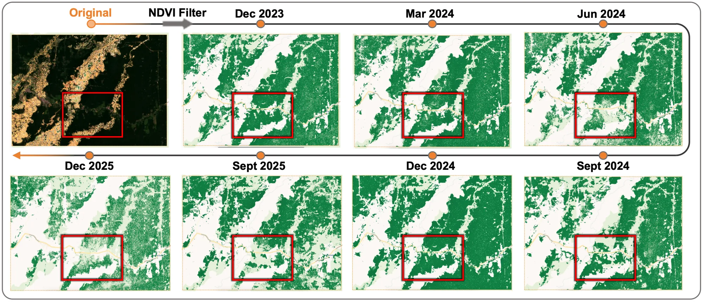

# NDVI monitoring

Follow vegetation health in one area over many dates without any model. NDVI turns each image into a map of how green and vigorous the vegetation is, and Temporal Playback steps through the dates so you can see where it declined or recovered.

| | |
|---|---|
| **You will** | Show NDVI for one AOI on every date in a series, hide low values with a threshold and compare dates |
| **You need** | Multispectral imagery with a **near-infrared** band (satellite scenes or a multispectral drone camera), several dates of the same area, and a saved AOI |
| **In the demo video** | [07:22 Temporal playback](https://www.youtube.com/watch?v=KoLlAJi2LYg&t=442s) |
| **Based on** | The NDVI temporal monitoring case in the GeoTALOS paper (Figure 8) |

<figure class="doc-figure">
  
  <figcaption>NDVI monitoring: an NDVI filtering step and date-indexed vegetation maps over one AOI; the arrows show the order to inspect them. Figure 8 of the GeoTALOS paper (SIGSPATIAL 2026).</figcaption>
</figure>

In the paper, the series covers seven dates from December 2023 to December 2025. The same AOI and filtering rule are applied to every date, so differences between images come from the vegetation, not from a different area or setting.

!!! note "Standard drone photos will not work"
    A normal RGB drone camera records red, green and blue only. NDVI needs a near-infrared band, so use multispectral or satellite imagery.

## What NDVI shows

NDVI compares near-infrared light, which healthy leaves reflect strongly, with red light, which they absorb. Values run from -1 to 1:

| NDVI | Usually means |
|---|---|
| Below 0 | Water |
| Around 0 to 0.2 | Bare soil, rock, built-up areas |
| 0.2 to 0.5 | Sparse or stressed vegetation |
| Above 0.5 | Dense, healthy canopy |

These ranges are typical, not fixed; they vary with sensor, season and vegetation type.

## Step 1: Upload the series

Upload every date of the same area, with the capture date in each file name, for example `2024-03-15_forest.tif`. See [Capture dates](../user-guide/uploading-imagery.md#capture-dates).

## Step 2: Draw the AOI

Draw and save an AOI over the area to monitor. Keep it the same for every date: in the paper's figure, the red rectangle marks the same AOI on all seven images.

## Step 3: Show NDVI through time

1. Select the AOI and open **Temporal Playback**.
2. Set **Index** to **NDVI**.
3. Check the bands. GeoTALOS picks the near-infrared and red bands on its own; if your sensor stores them in another order, pick them by hand.
4. The legend shows **Bare / stressed** at the low end and **Healthy canopy** at the high end.

## Step 4: Hide what you do not care about

Raise the **Threshold** slider to hide low NDVI values. At about 0.5, bare ground and stressed vegetation disappear and only healthy canopy stays coloured. Keep the same threshold for every date so they compare fairly.

## Step 5: Compare the dates

Press **Play** (or Space) to step through the series, or use **Previous** and **Next** (← and →). Look for patches where healthy canopy shrinks between dates. Limit playback to a season with **From date** and **To date** if you want to compare like with like, since vegetation changes naturally through the year.

## Other indices with the same steps

Swap **NDVI** for another index to follow something else:

| Index | Follow |
|---|---|
| **NDMI** | Canopy moisture and drought stress |
| **NDWI** | Open water: ponds, flooding, wetlands |
| **NBR** | Burned areas |
| **NDRE** | Stress in dense canopy |
| **GNDVI** | Chlorophyll and nitrogen |

Each needs its own bands. See [Temporal analysis](../user-guide/temporal-analysis.md).

## Next

- [Temporal feature mapping](temporal-feature-mapping.md): map specific features on every date with a model
- [Automation](../user-guide/automation.md): run monitoring whenever new imagery arrives
