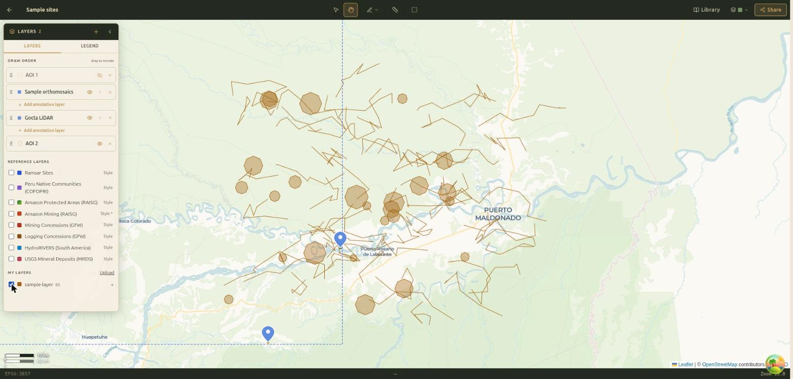
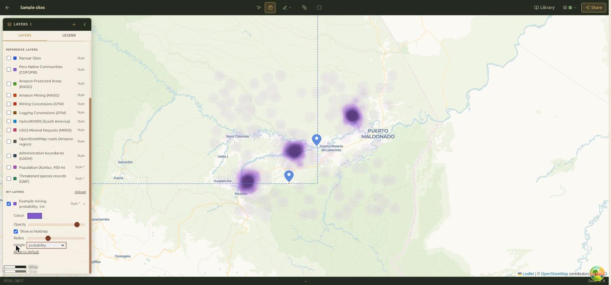

# My layers

My layers are vector layers that you upload yourself, such as a field survey, a road network from your NGO or your own study plots. They show next to the [reference layers](reference-layers.md) and belong to your organization. Other organizations cannot see them.

<figure class="doc-figure">
  
  <figcaption>An uploaded layer on the map. It is listed under **My layers** with the number of features it holds.</figcaption>
</figure>

## What you can upload

| File | Notes |
|---|---|
| `.geojson`, `.json` | A GeoJSON FeatureCollection, a single Feature or a bare geometry. Points, lines and polygons all work. |
| `.csv` | One row per feature. The location comes from a column of WKT shapes (`wkt` or `geometry`), or from longitude and latitude columns (`lon` and `lat`, or `longitude` and `latitude`). |

Limits: 50 MB per file and 100,000 features. Coordinates must be longitude and latitude (EPSG:4326).

Numbers in a CSV are stored as numbers (for example `0.75` or `12`), so they can weight a heatmap. Values with a leading zero, like a code `00123`, stay text.

A shapefile or GeoPackage is not accepted yet. In QGIS, right click the layer, choose **Export**, then **Save Features As**, pick **GeoJSON** and upload the result.

## Upload a layer

1. Open a map and find **My layers** at the bottom of the layers panel.
2. Choose **Upload** and pick your file.
3. When it finishes you see a message with the number of features that were added. The layer appears in the list.
4. Tick the box to show it. The map moves to the layer.

The layer takes its name from the file name. If your organization already has a layer with that name, the upload is refused: delete the old one first, or rename your file.

## Features that were skipped

GeoTALOS checks every feature. A feature is skipped, and counted in the message, when it has no location, is empty, has coordinates that are not longitude and latitude, or has an invalid shape such as a polygon that crosses itself. The message shows the reason for the first few. The rest of the file is still added.

If every feature is skipped, nothing is added and you see why.

## Attributes

Every column or property in your file is kept. Hover over the layer name to see the list. Numbers, text and true or false values are kept as they are. A list or a nested object is stored as text.

## Change how a layer looks

Every uploaded layer has a **Style** button, the same as the reference layers. It sets:

- **Colour** and **Opacity**.
- **Show as heatmap**: one soft blob per feature, at every zoom level. Polygons and lines use a point inside each shape.
- **Radius**: how wide each blob is.
- **Weight**: **Number of features** counts every feature the same. Any column that holds only numbers is listed too. Pick one, for example a probability or a count, and features with a higher value count for more. The scale follows the largest value in the column, so a probability from 0 to 1 works as well as an area in hectares.

<figure class="doc-figure">
  
  <figcaption>An uploaded example file with a probability column, drawn as a heatmap weighted by probability.</figcaption>
</figure>

The style is saved for your organization, so everyone in it sees the same look. **Reset to default** goes back to the default colour.

## Delete a layer

Use the **x** next to the layer name. Deleting removes the layer and all its features for your organization, so GeoTALOS asks you to confirm. Only admins can delete a layer.

## Good to know

- Clicking a feature does not show its attributes yet.
- Large or very detailed data, such as a country road network with millions of lines, is better built as a tileset by an administrator. See [Tiles, caching and reference layers](../developer/tiles.md).

## Related

- [Reference layers](reference-layers.md)
- [Reviewing annotations](reviewing-annotations.md): to bring in labels for an annotation set instead
