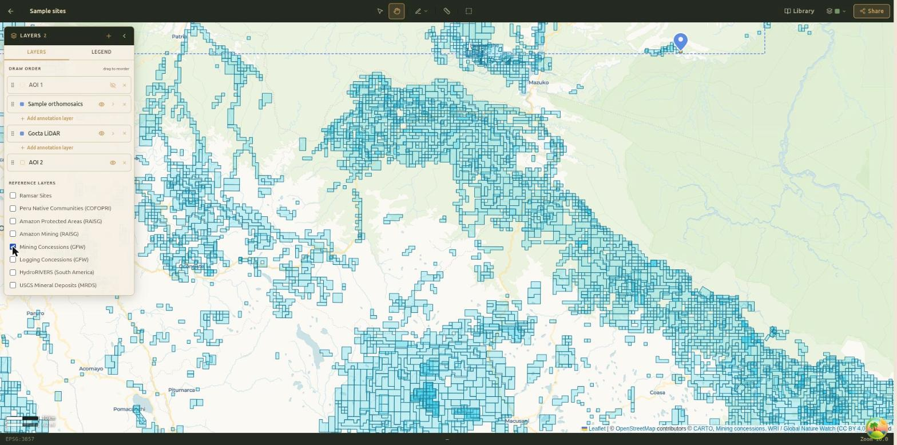
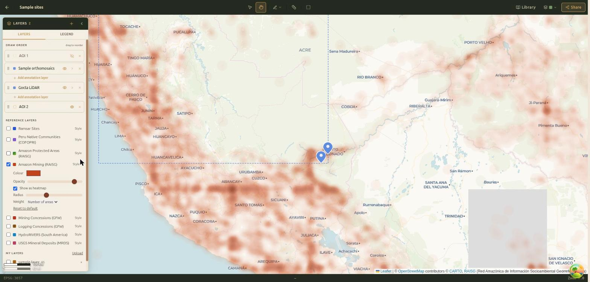

# Reference layers

Reference layers are public maps you can switch on over your own imagery for context: where the wetlands, protected areas, mining and logging concessions and rivers are. They are the same for every organization and nobody can edit them.

## Available layers

| Layer | Shows | Covers | Source |
|---|---|---|---|
| **Ramsar Sites** | Wetlands of international importance | Worldwide | Ramsar Sites Information Service (CC BY 4.0) |
| **Amazon protected areas** | Protected areas | Amazon basin | RAISG |
| **Amazon mining** | Mining areas | Amazon basin | RAISG |
| **Mining concessions** | Mining concession boundaries | Worldwide | Global Forest Watch (CC BY 4.0) |
| **Logging concessions** | Logging concession boundaries | Worldwide | Global Forest Watch / WRI |
| **HydroRIVERS** | River network | South America | HydroSHEDS |
| **USGS mineral deposits** | Mineral deposit locations | Worldwide | USGS MRDS (public domain) |
| **OpenStreetMap roads** | Main roads, unclassified roads and tracks | Amazon region (nine countries) | OpenStreetMap contributors (ODbL), via Geofabrik |
| **Peru native communities** | Native community lands | Peru | COFOPRI via GEOCATMIN |

Licences and download links for each are in [Data sources and licences](../reference/data-sources.md). Check the publisher's terms before reusing a layer outside GeoTALOS.

## Turn a layer on

1. Open a map.
2. In the layers panel on the left, find the **Reference layers** section.
3. Switch on the layers you want. Switch a layer off the same way.

Each layer's credit appears in the attribution line at the bottom of the map while it is on.

<figure class="doc-figure">
  
  <figcaption>Mining concessions (Global Forest Watch) over the Cusco and Madre de Dios region. Where concessions overlap in large numbers the boxes crowd together at low zoom.</figcaption>
</figure>

<figure class="doc-figure">
  
  <figcaption>Amazon protected areas, Peru native communities and rivers switched on together. The layer credits appear in the attribution line at the bottom.</figcaption>
</figure>

## Change how a layer looks

Every layer has a **Style** button in the layers panel. It opens the controls for that layer:

| Control | Does |
|---|---|
| **Colour** | The colour of the layer's lines and fills |
| **Opacity** | How see-through the layer is |
| **Show as heatmap** | Draws a dense layer as a heatmap (see below). Only on layers that have one. |
| **Radius** | How far each mining area spreads in the heatmap |
| **Weight** | What the heatmap adds up: the **number of areas**, or their **area** in hectares |
| **Reset to default** | Back to the original look |

Your choices are saved for your organization, so the next person who opens a map sees the same look. Members and admins can change a layer's style. Viewers can look but not save. A star next to **Style** means the layer has been changed.

<figure class="doc-figure">
  
  <figcaption>The Amazon Mining layer as a heatmap, with its style controls open.</figcaption>
</figure>

## Heatmaps for dense layers

Mining concessions are drawn as thousands of small boxes that overlap and hide each other when you zoom out. A **heatmap** shows the same layer as a soft colour surface instead: pale where there is little mining, dark where there is a lot. It is also much lighter to load.

- The heatmap is available for **Amazon mining (RAISG)** and **Mining concessions (GFW)**.
- It shows from the most zoomed out view down to zoom level 9. From zoom level 10 the real boxes appear, because at that scale the areas are far enough apart to see one by one.
- With **Weight** set to **Number of areas**, every mining area counts the same. Set it to **Area** and large areas count for more.

<figure class="doc-figure">
  
  <figcaption>The same kind of layer drawn as boxes: hard to read where they overlap.</figcaption>
</figure>

## Good to know

- **Zoom range.** Each layer is drawn only between certain zoom levels. If a layer is on but you see nothing, zoom in or out, or move to the region it covers.
- **Not saved with the map.** Which reference layers are on is remembered only while the map is open. Switch them on again after reloading the page.
- **Read only.** You cannot edit reference layers or run models on them. To compare your results with a reference layer, view both on the same map.
- **Missing layer.** If a layer is not in the list, it has not been loaded on your GeoTALOS server yet. Ask your administrator. Developers can rebuild layers with the steps in [Tiles, caching and reference layers](../developer/tiles.md).

## Example uses

- Check whether palm detections fall inside a protected area.
- See which mining concessions overlap an area where your imagery shows forest loss.
- Use HydroRIVERS to find river sections near detected mining activity.
